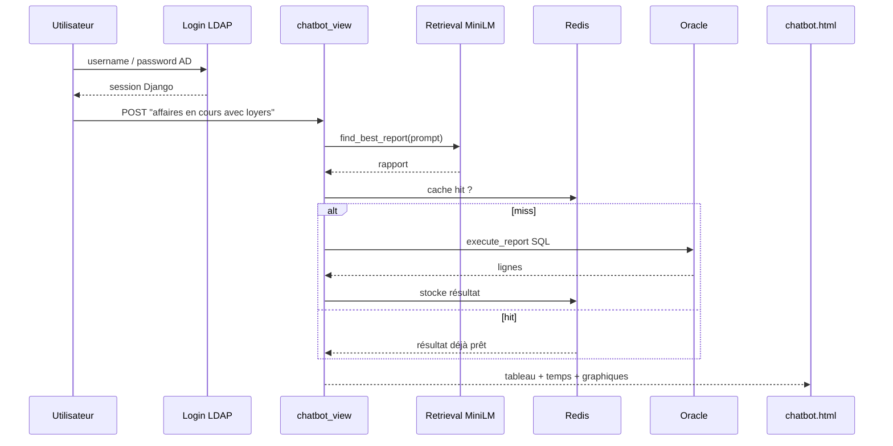

# Finorix (BH Leasing) — Fiche complète (RAG + Interview)

> Stage : août–septembre 2025 · Chatbot NLP pour interroger Oracle en langage naturel  
> Stack : Python, Django, Sentence Transformers (MiniLM), Oracle, Redis, LDAP/AD, Chart.js, Bootstrap

---

# PARTIE 1 — Workflow et « RAG »

## Workflow global



1. Connexion AD  
2. Question en langage naturel  
3. Retrieval du meilleur rapport  
4. Exécution SQL (ou cache)  
5. Affichage des données  

---

## Comment le « RAG » fonctionne ici

Ce n’est **pas** un RAG classique avec LLM qui génère une réponse texte.

C’est un **RAG de rapports** :

| Étape RAG classique | Dans Finorix |
|---|---|
| **Retrieval** | Oui — embeddings + similarité cosine |
| **Augmented** | Le contexte = le rapport JSON choisi (surtout `requete_sql`) |
| **Generation** | Non LLM — exécution SQL Oracle + rendu tableau |

**En bref :** trouver le bon rapport, puis l’exécuter, pas écrire une réponse.

---

## Phase 0 — Indexation (au démarrage)

Quand Django charge `utils.py` :

1. Lecture de `rapports.json` (~41 documents = base de connaissances).
2. Chargement du modèle `all-MiniLM-L6-v2`.
3. Pour chaque rapport, construction d’un texte indexé :

   `titre + ". " + description + ". " + exemples_questions`

Exemple rapport #1 :

```text
Etat des affaires par statut avec détails financiers.
Pour chaque affaire, affiche son statut...
Montre-moi les affaires en cours avec leur montant et durée
Quelles sont les affaires actives et leurs loyers ? ...
```

4. Encodage → vecteurs stockés en mémoire (`embeddings`).

C’est l’équivalent d’un **vector store en RAM** (pas FAISS/Chroma ici).

---

## Phase 1 — Retrieval (`find_best_report`)

Quand l’utilisateur envoie un prompt :

```python
def find_best_report(user_prompt):
    user_emb = model.encode(user_prompt, convert_to_tensor=True)
    scores = util.cos_sim(user_emb, embeddings)[0]
    idx = scores.argmax().item()
    return reports[idx]
```

1. La question est transformée en vecteur.
2. Similarité cosine avec les 41 embeddings.
3. On prend l’`argmax` (meilleur score).
4. On retourne l’objet rapport complet (titre, SQL, etc.).

| Question utilisateur | Rapport probable |
|---|---|
| « Montre les affaires actives et leurs loyers » | #1 État des affaires par statut… |
| « Durée moyenne des contrats » | #5 Durée moyenne… |

Les `exemples_questions` du JSON servent d’**ancres sémantiques** pour coller le langage métier au bon rapport.

**Limite importante :** pas de seuil. Même une question hors sujet renvoie un rapport (le « moins mauvais »).

---

## Phase 2 — « Augmentation » + exécution

Une fois le rapport trouvé, `chatbot_view` :

1. Construit une clé cache : `report_{id}_{hash(params)}`
2. Si Redis a déjà le résultat → le réutilise
3. Sinon → `execute_report(report, POST)`

```python
def execute_report(report, params, row_limit=6000):
    ...
    query = report["requete_sql"]
    limited_query = f"""
        SELECT * FROM (
            {query}
        ) WHERE ROWNUM <= {row_limit}
    """
    ...
    return results  # list[dict]
```

Le SQL préécrit dans le JSON est exécuté sur Oracle (max 6000 lignes).  
Le résultat (données métier) = le contenu « augmenté » affiché à l’utilisateur.

---

## Phase 3 — Réponse UI (à la place de la génération LLM)

Django renvoie `chatbot.html` avec :

- le tableau de résultats
- `search_time` (retrieval)
- `execution_time` (SQL ou cache)
- `from_cache`
- puis Chart.js côté client pour l’analyse visuelle

Il n’y a **pas** de phrase générée du type « Voici un résumé… » par un modèle de langage.

---

## Schéma mental du RAG Finorix

```text
┌─────────────────────────────────────────────┐
│  Knowledge base = rapports.json             │
│  (titre, desc, exemples, requete_sql)       │
└──────────────────┬──────────────────────────┘
                   │ encode MiniLM (startup)
                   ▼
            Vecteurs en mémoire
                   │
User question ─────┼──► cosine similarity
                   ▼
            Best report (Top-1)
                   │
                   ▼
         SQL Oracle (+ Redis)
                   │
                   ▼
         Tableau / graphiques
```

---

## Workflow bout-en-bout en 1 phrase

L’utilisateur pose une question → MiniLM retrouve le rapport le plus proche dans `rapports.json` → la requête SQL de ce rapport tourne sur Oracle (ou Redis) → les lignes sont affichées.

---

# PARTIE 2 — Questions & réponses d’interview

## 1. Pitch (30–60 secondes)

**Q : Présente ton projet en 1 minute.**

**R :** Pendant mon stage chez BH Leasing, j’ai conçu et développé **Finorix**, un chatbot web interne. Les équipes métier posent une question en français (« affaires en cours avec leurs loyers ») ; le système retrouve le rapport SQL le plus proche parmi ~41 rapports prédéfinis grâce à une recherche sémantique (Sentence Transformers), exécute la requête sur **Oracle**, met le résultat en cache **Redis**, et affiche un tableau + graphiques dans une interface Django. L’accès est sécurisé via **Active Directory (LDAP)**. L’app a été déployée sur une VM du réseau interne avec IP fixe et démarrage automatique via le Planificateur de tâches Windows.

---

## 2. Contexte métier & problème

**Q : Quel problème métier résolvez-vous ?**

**R :** Les collaborateurs avaient besoin de données leasing (affaires, échéances, risques, durées, loyers…) stockées dans Oracle, mais sans forcément maîtriser SQL ni passer par un outil BI lourd. Finorix leur permet d’obtenir un rapport métier via une question en langage naturel, avec export et analyses côté UI.

**Q : Pourquoi des rapports SQL préécrits plutôt qu’un LLM qui génère du SQL ?**

**R :** En entreprise, générer du SQL librement pose des risques : requêtes incorrectes, perf, sécurité (injection), et hallucinations. Avec des rapports validés dans `rapports.json`, on garantit des requêtes métier correctes. Le NLP sert uniquement à **router** la question vers le bon rapport, pas à inventer du SQL.

---

## 3. Architecture globale

**Q : Explique l’architecture de bout en bout.**

**R :**
1. Login LDAP → session Django  
2. POST d’une question → `chatbot_view`  
3. `find_best_report` (MiniLM + cosine) → meilleur rapport JSON  
4. Clé Redis `report_{id}_{hash(params)}` → hit = résultat immédiat ; miss = `execute_report` sur Oracle  
5. Rendu `chatbot.html` : tableau, temps (search / exec / total), cache flag, Chart.js, filtres, export  

**Composants :**
| Couche | Techno |
|---|---|
| Auth | LDAP / Active Directory |
| Backend | Django (`views.py`, `utils.py`) |
| NLP | `all-MiniLM-L6-v2` + cosine similarity |
| Knowledge | `rapports.json` (~41 rapports) |
| Data | Oracle via `cx_Oracle` |
| Cache | Redis (`django-redis`) |
| Front | HTML/CSS/JS, Bootstrap, Chart.js |

**Q : Pourquoi Django + SQLite + Oracle séparés ?**

**R :** SQLite sert à Django (users, sessions, auth locale). Oracle est la **base métier** leasing, interrogée en direct via `cx_Oracle` (pas via l’ORM Django pour les rapports). Redis est un cache de résultats, pas une base métier.

---

## 4. NLP / « RAG » (questions fréquentes & pièges)

**Q : C’est un RAG ?**

**R :** Oui dans l’esprit retrieval + contexte, **non** dans le sens RAG+LLM classique.  
- **Retrieval** : embeddings + similarité cosine  
- **Augmented** : le rapport JSON (surtout `requete_sql`)  
- **Generation** : pas de LLM — exécution SQL + rendu tableau  

C’est un **RAG de rapports** : trouver le bon rapport puis l’exécuter.

**Q : Comment marche le matching sémantique ?**

**R :** Au démarrage (`utils.py`), pour chaque rapport on concatène `titre + description + exemples_questions`, on encode avec MiniLM, on stocke les vecteurs en mémoire. À chaque question : encode le prompt → `cos_sim` → `argmax` → retourne le rapport. Les `exemples_questions` sont des ancres sémantiques pour coller le vocabulaire métier.

**Q : Pourquoi MiniLM / Sentence Transformers ?**

**R :** MiniLM (`all-MiniLM-L6-v2`) encode des phrases (question + textes des rapports) en vecteurs pour le matching. Raisons concrètes :
1. **Léger et rapide** — modèle compact, bon pour une VM interne / démarrage Django, sans GPU obligatoire.
2. **Fait pour la similarité de phrases** — Sentence Transformers colle des formulations proches (« loyers des affaires actives » ≈ « affaires en cours avec montant »).
3. **Corpus petit (~41 rapports)** — pas besoin d’un gros modèle (MPNet, E5 large…) : gain faible face au coût CPU/RAM.
4. **Français métier court** — suffisant pour du routing de questions, sans être un LLM génératif.

Phrase orale : *« On n’avait pas besoin de génération de texte, juste de router une question vers un rapport. MiniLM est un bon compromis qualité / latence / infra. »*

**Q : Pourquoi cosine similarity et pas L2 (distance euclidienne) ?**

**R :** Les deux comparent des vecteurs, mais elles ne mesurent pas la même chose :

| | Cosine | L2 (euclidienne) |
|---|---|---|
| Mesure | **Angle** entre vecteurs (direction = sens) | **Distance** brute dans l’espace |
| Sensible à la norme \|v\| ? | Non | Oui |
| « Proche » | score proche de **1** | distance proche de **0** |

Pourquoi cosine dans Finorix :
1. **On compare du sens, pas une magnitude** — deux phrases similaires doivent être proches en **direction** ; la longueur du vecteur peut varier selon le wording.
2. **Standard Sentence Transformers** — entraînés / évalués avec cosine (ou produit scalaire sur vecteurs normalisés).
3. **Plus lisible** — score de similarité 0→1, pratique pour un futur seuil de confiance.

Note : si les embeddings sont normalisés (\(\|u\|=\|v\|=1\)), cosine et L2 sont liés : \(\|u-v\|^2 = 2 - 2\cos\theta\). Le Top-1 peut être le même, mais cosine reste plus adapté et interprétable pour la similarité sémantique.

L2 aurait du sens pour du clustering / k-NN sur features où la **magnitude** compte. Pour du text embedding → **cosine** (choix habituel).

Phrase orale : *« MiniLM pour encoder vite et bien ; cosine parce qu’on compare l’orientation sémantique, pas la distance brute. »*

**Q : Limites de ton approche NLP ?**

**R :**
1. **Pas de seuil** : une question hors sujet renvoie quand même le « moins mauvais » rapport.  
2. **Top-1 uniquement** : pas de Top-k ni confirmation utilisateur.  
3. **Corpus fermé** : seules les questions proches des 41 rapports sont bien couvertes.  
4. **Pas de multi-intent** : une question qui mélange deux besoins n’exécute qu’un rapport.  

**Améliorations possibles :** seuil de confiance + message « je n’ai pas compris », Top-3 avec choix, feedback utilisateur, fine-tuning / meilleurs exemples.

**Q : Différence embeddings vs TF-IDF / mots-clés ?**

**R :** TF-IDF matche des mots exacts ; les embeddings capturent le **sens** (« loyers des affaires actives » ≈ « affaires en cours avec montant et durée »), ce qui est crucial en langage métier varié.

---

## 5. Oracle & SQL

**Q : Comment exécutes-tu les requêtes ?**

**R :** `execute_report` lit `requete_sql` du rapport, l’enveloppe dans un `SELECT * FROM (...) WHERE ROWNUM <= 6000`, se connecte via DSN Oracle (`cx_Oracle`), fetch les lignes, mappe colonnes → `list[dict]`.

**Q : Pourquoi limiter à 6000 lignes ?**

**R :** Protéger perf et mémoire (UI + cache Redis). Les analyses Chart.js et filtres côté client restent utilisables. C’est un compromis métier/perf.

**Q : Que contient `rapports.json` ?**

**R :** Pour chaque rapport : `id`, `titre`, `description`, `categorie`, `tags`, `tables`, `colonnes` (métadonnées), `parametres`, `exemples_questions`, `filtres_possibles`, `requete_sql`. C’est à la fois la base de connaissances NLP et le catalogue métier.

**Exemples de rapports :** état des affaires par statut, risque par affaire, échéances par mois, durée moyenne des contrats, situation des contrats, etc.

---

## 6. Redis & performance

**Q : Pourquoi Redis ?**

**R :** Les requêtes Oracle métier peuvent être lourdes. Mettre le résultat en cache évite de rejouer le SQL pour la même combinaison rapport + paramètres. On mesure `search_time`, `execution_time`, `from_cache` pour rendre la perf visible.

**Q : Comment construis-tu la clé de cache ?**

**R :** `report_{id}_{hash(params)}` où `params` = POST hors CSRF et hors prompt. Ainsi deux questions différentes qui matchent le **même** rapport (mêmes params) partagent le cache.

**Q : TTL ?**

**R :** Dans la vue principale, `timeout=None` (persistant jusqu’invalidation/redémarrage Redis). Le preload utilise parfois 3600 s. En interview, je préciserais qu’idéalement on mettrait un TTL métier + invalidation quand les données Oracle changent.

**Q : Que se passe-t-il au cold start ?**

**R :** Premier chargement de Django : chargement JSON + encode des 41 rapports (MiniLM). Premier hit d’un rapport : SQL Oracle. Ensuite : cache Redis.

---

## 7. Authentification LDAP / AD

**Q : Comment fonctionne le login ?**

**R :**
1. Bind avec un compte service sur le serveur LDAP  
2. Recherche `sAMAccountName=username` sous le `BASE_DN`  
3. Bind final avec le DN utilisateur + mot de passe (vérif credentials)  
4. `get_or_create` d’un User Django avec mot de passe inutilisable  
5. `login()` session Django ; signup désactivé (comptes gérés par AD)

**Q : Pourquoi LDAP et pas des comptes Django classiques ?**

**R :** Contexte entreprise : comptes déjà dans Active Directory, SSO-like interne, pas de gestion de mots de passe locaux, conformité IT.

**Q : Sécurité — points à mentionner (et à améliorer) ?**

**R :** Points positifs : auth obligatoire (`@login_required`), pas de création de compte libre, SQL figé (pas généré).  
Points à améliorer (montre maturité) : secrets hors code (env/Vault), `DEBUG=False` en prod, `ALLOWED_HOSTS` restreint, HTTPS, TTL cache, seuil NLP, logs d’audit des requêtes.

> En interview : **ne jamais réciter de mots de passe / IPs / comptes** même s’ils sont dans le repo. Dire « stockés en config / à externaliser ».

---

## 8. Frontend & UX

**Q : Qu’offre l’interface après une réponse ?**

**R :** Tableau des résultats, temps de recherche/exécution, indication cache, filtres (texte, numérique, date, colonne), tri, pagination, sélection de lignes, export CSV/XLSX, presse-papier, analyses Chart.js (dont scatter / corrélations / valeurs aberrantes selon les features UI).

**Q : Pourquoi filtrer côté client ?**

**R :** Une fois le jeu de données (≤ 6000 lignes) chargé, les filtres/tri/graphiques sont instantanés sans re-solliciter Oracle. Trade-off : volume borné côté serveur.

---

## 9. Déploiement

**Q : Comment as-tu déployé Finorix ?**

**R :** Sur une **VM** du réseau interne BH Leasing, avec **IP fixe** pour l’accès collaborateurs, lancement automatique via le **Planificateur de tâches Windows**, et packaging/lancement (launcher / PyInstaller selon le setup). Redis et l’accès Oracle/LDAP sont sur le réseau interne.

**Q : Contraintes d’un déploiement on-prem entreprise ?**

**R :** Pas d’accès cloud public, dépendances réseau (AD, Oracle), droits IT, démarrage fiable après reboot, perf sur machine limitée, secrets et politiques de sécurité internes.

---

## 10. Décisions techniques & trade-offs

**Q : Pourquoi pas ChatGPT / un LLM local pour répondre en texte ?**

**R :** Besoin = **données exactes** (chiffres contrats), pas un résumé approximatif. Un LLM ajoute coût, latence, risque d’erreur. Ici la « réponse » est le résultat SQL fiable. (Des libs LLM existent dans `requirements` / essais, mais le flux prod est matching + SQL.)

**Q : Pourquoi pas FAISS / Chroma / pgvector ?**

**R :** 41 documents : cosine en mémoire suffit. Moins d’infra à maintenir en stage/on-prem. À l’échelle (milliers de rapports), un vector store serait justifié.

**Q : Top-1 vs Top-k ?**

**R :** Top-1 = UX simple (1 question → 1 tableau). Top-k serait mieux quand deux rapports sont proches en score : afficher 2–3 propositions à l’utilisateur.

---

## 11. Difficultés rencontrées (STAR)

**Q : Quelle difficulté as-tu rencontrée ?**

**Exemple 1 — Matching métier**  
- **S :** Les formulations utilisateurs ≠ titres techniques des rapports.  
- **T :** Améliorer le rappel du bon rapport.  
- **A :** Enrichir `exemples_questions` + description ; indexer titre+desc+exemples.  
- **R :** Meilleure association questions naturelles ↔ rapports.

**Exemple 2 — Perf Oracle**  
- **S :** Certaines requêtes lentes / volumineuses.  
- **T :** Temps de réponse acceptables.  
- **A :** `ROWNUM` 6000 + cache Redis + mesure des timings dans l’UI.  
- **R :** Hits cache quasi instantanés ; volume UI maîtrisé.

**Exemple 3 — Auth entreprise**  
- **S :** Comptes gérés par AD, pas d’inscription libre.  
- **T :** Login sécurisé intégré au SI.  
- **A :** Flux LDAP (service bind → search → user bind) + User Django miroir.  
- **R :** Accès réservé aux collaborateurs AD.

---

## 12. Améliorations si tu avais plus de temps

1. Seuil de similarité + message d’échec / reformulation  
2. Top-3 suggestions cliquables  
3. Paramètres dynamiques de rapport (dates, client) injectés proprement dans SQL (bind variables)  
4. Invalidation / TTL Redis aligné sur la fraîcheur des données  
5. Tests automatisés (matching, login mock LDAP, execute mock Oracle)  
6. Observabilité : logs structurés, taux de bons matchs, feedback 👍/👎  
7. Secrets hors repo, hardening Django prod  
8. (Option avancée) couche LLM **uniquement** pour reformuler / expliquer le tableau, pas pour générer le SQL  

---

## 13. Questions « deep dive » probables

**Q : Cosine similarity, c’est quoi ?**  
**R :** Mesure d’angle entre deux vecteurs (indépendante de la norme). Score proche de 1 = phrases sémantiquement proches. On prend l’argmax sur les 41 scores.

**Q :** `hash(frozenset(params))` — attention ?  
**R :** En Python, `hash()` n’est pas stable entre process si `PYTHONHASHSEED` varie — point faible pour une clé de cache distribuée. Mieux : hash stable (SHA256 JSON canonic). Bon point d’autocritique en interview.

**Q : Injection SQL ?**  
**R :** Le SQL vient du JSON maîtrisé, pas du texte utilisateur. Le prompt ne fait que choisir l’id du rapport. Si un jour on injecte des paramètres user dans le SQL, il faudrait des **bind variables** Oracle, jamais de concaténation brute.

**Q : Que se passe-t-il si MiniLM se trompe de rapport ?**  
**R :** L’utilisateur voit un tableau « à côté » du besoin. D’où l’intérêt d’un score + confirmation, et de bons `exemples_questions`. On peut aussi afficher le titre du rapport matché pour que l’utilisateur valide mentalement.

**Q : Différence Sentence Transformer vs tokenizer classique ?**  
**R :** Un ST encode une phrase entière en un vecteur dense entraîné pour la similarité sémantique ; un tokenizer découpe juste en tokens sans notion de proximité de sens.

---

## 14. Questions que TU peux poser à l’intervieweur

- Utilisez-vous déjà de la recherche sémantique / RAG en interne ?  
- Préférez-vous SQL gouverné (comme Finorix) ou Text-to-SQL avec garde-fous ?  
- Quels SLAs sur la fraîcheur des données (temps réel vs cache) ?  

---

## 15. Checklist révision rapide (la veille)

- [ ] Pitch 60 s  
- [ ] Schéma : User → LDAP → Django → MiniLM → Redis/Oracle → UI  
- [ ] « RAG de rapports » vs RAG+LLM  
- [ ] MiniLM + cosine + argmax + exemples_questions  
- [ ] Limite ROWNUM 6000 + clé cache  
- [ ] LDAP : service bind → search → user bind  
- [ ] Déploiement VM + IP fixe + Task Scheduler  
- [ ] 3 limites + 3 améliorations  
- [ ] 1 story STAR (matching ou perf ou LDAP)  

---

## Réponse « filet de sécurité » si tu bloques

> « Dans Finorix, la question utilisateur ne génère pas de SQL. Elle est embeddée avec MiniLM, comparée aux 41 rapports de `rapports.json`, le meilleur est exécuté sur Oracle (avec cache Redis), et le résultat est affiché en tableau/graphiques derrière une auth Active Directory. »
